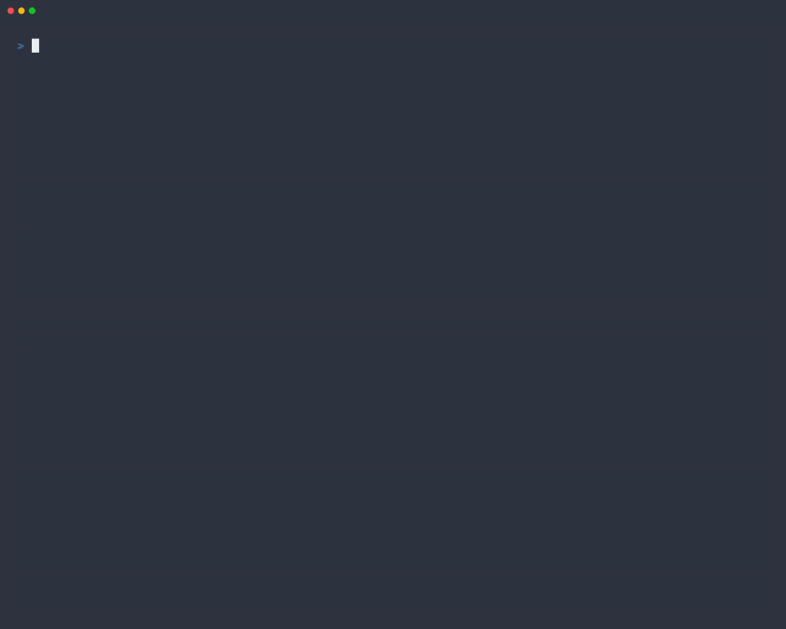

# typerace

TypeRacer-style typing races in your terminal. Type quotes from movies, TV,
books, speeches and songs word by word, then see your speed over the race and
speedcubing-style averages.



- **About 6,500 quotes**, short to very long, mixed like TypeRacer. You won't
  see a quote again until you've done every quote of its length.
- **Word by word, like the website**: the input box holds the current word and
  clears once it's right. Mistakes show red and have to be fixed.
- **Results**: speed, accuracy, peak, pace through the race, a chart of your
  speed with typos marked, and your best single, ao5, ao12, ao25, ao50 and
  ao100, plus your last 12 races.
- Lightweight: one Python file plus the quotes, no dependencies on Linux or
  macOS. Colours follow your terminal's theme.

## Install

```sh
pipx install typerace          # or: uv tool install typerace
```

**Homebrew** (macOS, Linux):

```sh
brew install elliottkobelansky/tap/typerace
```

**Debian / Ubuntu**: download the `.deb` from the
[latest release](https://github.com/elliottkobelansky/typerace/releases/latest), then

```sh
sudo apt install ./typerace_*_all.deb
```

Needs Python 3.9 or newer. On Windows, `pipx install typerace` also installs
`windows-curses`.

## Use

```sh
typerace                 # a random quote, mixed lengths
typerace short           # or medium, long, verylong
typerace --history       # recent races and your averages
```

| Key | |
| --- | --- |
| Ctrl+Backspace, Ctrl+W, Alt+Backspace | clear the current word |
| Tab | skip to a new quote |
| Esc | quit (q also works on the results screen) |
| Enter | race again from the results screen |

If your terminal uses a [Nerd Font](https://www.nerdfonts.com/), set
`TYPERACE_NERD_FONT=1` to get a car on the race lane instead of `▶`.

## How it's scored

- **Speed** is `(characters typed ÷ 5) ÷ minutes`, the standard words-per-minute
  measure (a "word" is any 5 characters, spaces included). The timer starts at
  your first keypress and stops when you finish the last word. Typos aren't
  subtracted: you have to fix them, which costs time.
- **Accuracy** is correct keystrokes ÷ all keystrokes.
- **Peak** is your fastest stretch of at least 3 seconds (or 15% of the race).
- **Pace** is your speed in the first quarter, the middle half and the last
  quarter of the race.
- **ao5 … ao100** are averages of your last 5 … 100 races, speedcubing style:
  the fastest and slowest 5% (rounded up) are dropped, so 1 each for ao5 and
  ao12, 2 for ao25, 3 for ao50 and 5 for ao100.

Your races are saved in `$XDG_DATA_HOME/typerace` (normally
`~/.local/share/typerace`).

## Development

```sh
PYTHONPATH=src python3 -m typerace       # run from the source tree
python3 -m unittest discover -s tests    # tests (a full race is played in a pty)
sh packaging/build-deb.sh                # build dist/typerace_VERSION_all.deb
python3 tools/update_quotes.py           # refresh the quotes from Monkeytype
```

The demo GIF is recorded with [VHS](https://github.com/charmbracelet/vhs) by the
`demo` workflow (Actions tab → demo → Run workflow) from a tape that
`tools/demo.py` writes.

Releases: bump `__version__` in `src/typerace/__init__.py`, then push a tag
like `v0.2.0`. GitHub Actions builds the wheel, sdist and `.deb`, attaches them
to a GitHub release, and publishes to PyPI.

## Credits and licence

The quotes are Monkeytype's English quote collection, used under the GPL-3.0;
see [QUOTES.md](QUOTES.md). Each quote belongs to its original source.

typerace is licensed under the GNU General Public License v3.0 or later.
